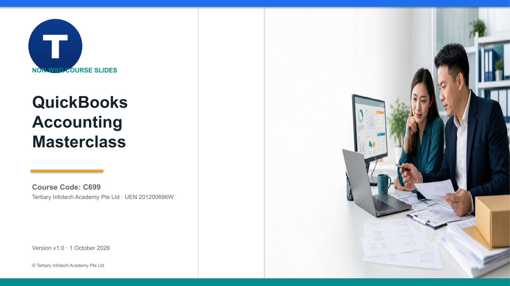

# QuickBooks Accounting Masterclass

A hands-on, two-day masterclass in controlled transactional accounting, financial reporting and accounting standards using QuickBooks Online.

| Course detail | Information |
|---|---|
| Course code | `C699` |
| Programme | Non-WSQ |
| Duration | 2 days · 15 hours (9:30am – 5:30pm) |
| Registration | [View course details and register](https://www.tertiarycourses.com.sg/quickbooks-accounting-masterclass.html) |
| Courseware version | v1.0 · 1 October 2026 |

## About the course

This masterclass takes learners beyond basic bookkeeping into controlled, evidence-based accounting in QuickBooks Online. Learners design a control-ready company file, run advanced order-to-cash and procure-to-pay cycles, reconcile inventory, projects, bank feeds and credit cards, post month-end adjustments and investigate the audit log. They then build a reconciled financial reporting pack, prepare a Singapore GST control working paper, and translate a change in accounting policy into the books and reports.

The course is suited to accountants, finance executives, bookkeepers and business owners who already know QuickBooks Online basics.

## Learning outcomes

- **LO1:** Perform advanced transactional accounting and double-entry accounting in a controlled QuickBooks Online workflow.
- **LO2:** Produce accurate financial statements, supporting schedules, and management reports from validated accounting data.
- **LO3:** Determine and communicate how reporting standards and accounting judgements affect financial information.

## Topics covered

1. **Topic 1 — Advanced Transactional Accounting:** control-ready company file, event-to-entry decisions, advanced order-to-cash and procure-to-pay, recurring transactions, inventory, projects, bank rules, reconciliation, month-end adjustments, close, roles and audit trail.
2. **Topic 2 — Financial Reporting and Management Insight:** statement architecture, subledger ties, report dimensions, custom reports, ageing, profitability and variance, cash flow, GST control and the management report pack.
3. **Topic 3 — Accounting Principles and Standards:** the Singapore reporting framework, accrual and matching, revenue recognition, inventory measurement, PPE, foreign currency, estimates and policy changes, and qualitative characteristics.

## Activities

Each activity folder is self-contained, with a guide, a workflow visual, mock CSV data and a formula-driven Excel control workbook. See [activities/README.md](activities/README.md).

- [Activity 01 — Design a Control-Ready Company File](activities/activity-01-design-a-control-ready-company-file/activity-01-design-a-control-ready-company-file.md)
- [Activity 02 — Run an Advanced Order-to-Cash Cycle](activities/activity-02-run-an-advanced-order-to-cash-cycle/activity-02-run-an-advanced-order-to-cash-cycle.md)
- [Activity 03 — Control Procure-to-Pay and Supplier Exceptions](activities/activity-03-control-procure-to-pay-and-supplier-exceptions/activity-03-control-procure-to-pay-and-supplier-exceptions.md)
- [Activity 04 — Reconcile Inventory Quantity and Value](activities/activity-04-reconcile-inventory-quantity-and-value/activity-04-reconcile-inventory-quantity-and-value.md)
- [Activity 05 — Measure Project Profitability and Billing Leakage](activities/activity-05-measure-project-profitability-and-billing-leakage/activity-05-measure-project-profitability-and-billing-leakage.md)
- [Activity 06 — Engineer Bank Rules and Feed Exceptions](activities/activity-06-engineer-bank-rules-and-feed-exceptions/activity-06-engineer-bank-rules-and-feed-exceptions.md)
- [Activity 07 — Resolve a Bank and Credit-Card Reconciliation](activities/activity-07-resolve-a-bank-and-credit-card-reconciliation/activity-07-resolve-a-bank-and-credit-card-reconciliation.md)
- [Activity 08 — Post and Reverse Month-End Adjustments](activities/activity-08-post-and-reverse-month-end-adjustments/activity-08-post-and-reverse-month-end-adjustments.md)
- [Activity 09 — Investigate Audit Log and Close-Control Breaches](activities/activity-09-investigate-audit-log-and-close-control-breaches/activity-09-investigate-audit-log-and-close-control-breaches.md)
- [Activity 10 — Build a Reconciled Financial Reporting Pack](activities/activity-10-build-a-reconciled-financial-reporting-pack/activity-10-build-a-reconciled-financial-reporting-pack.md)
- [Activity 11 — Prepare a GST Control and F5 Working Paper](activities/activity-11-prepare-a-gst-control-and-f5-working-paper/activity-11-prepare-a-gst-control-and-f5-working-paper.md)
- [Activity 12 — Capstone: Translate a Reporting Change into Books and Reports](activities/activity-12-capstone-translate-a-reporting-change-into-books-and-reports/activity-12-capstone-translate-a-reporting-change-into-books-and-reports.md)

## Public package

- [Slide deck (PPTX)](<courseware/QuickBooks Accounting Masterclass (C699)-v1.0.pptx>) · [PDF](<courseware/QuickBooks Accounting Masterclass (C699)-v1.0.pdf>)
- [Lesson Plan (DOCX)](<courseware/LP-QuickBooks Accounting Masterclass (C699).docx>) · [PDF](<courseware/LP-QuickBooks Accounting Masterclass (C699).pdf>)
- [Learner Guide (DOCX)](<courseware/LG-QuickBooks Accounting Masterclass (C699).docx>) · [PDF](<courseware/LG-QuickBooks Accounting Masterclass (C699).pdf>) · [Markdown](<LG-QuickBooks Accounting Masterclass (C699).md>)
- [activities/](activities/) — the 12 activity folders
- `tools/` — scripts used to build this courseware

Use only the fictional activity data and a QuickBooks Online practice company. Never upload real customer, payroll, bank or tax data.

## Distribution boundary

The courseware, activities and tooling in this repository are public. Credentials (`.env`) and any private reference material are excluded.

## Provider

Developed and delivered by [Tertiary Infotech Academy Pte Ltd](https://www.tertiarycourses.com.sg/) (UEN 201200696W).
